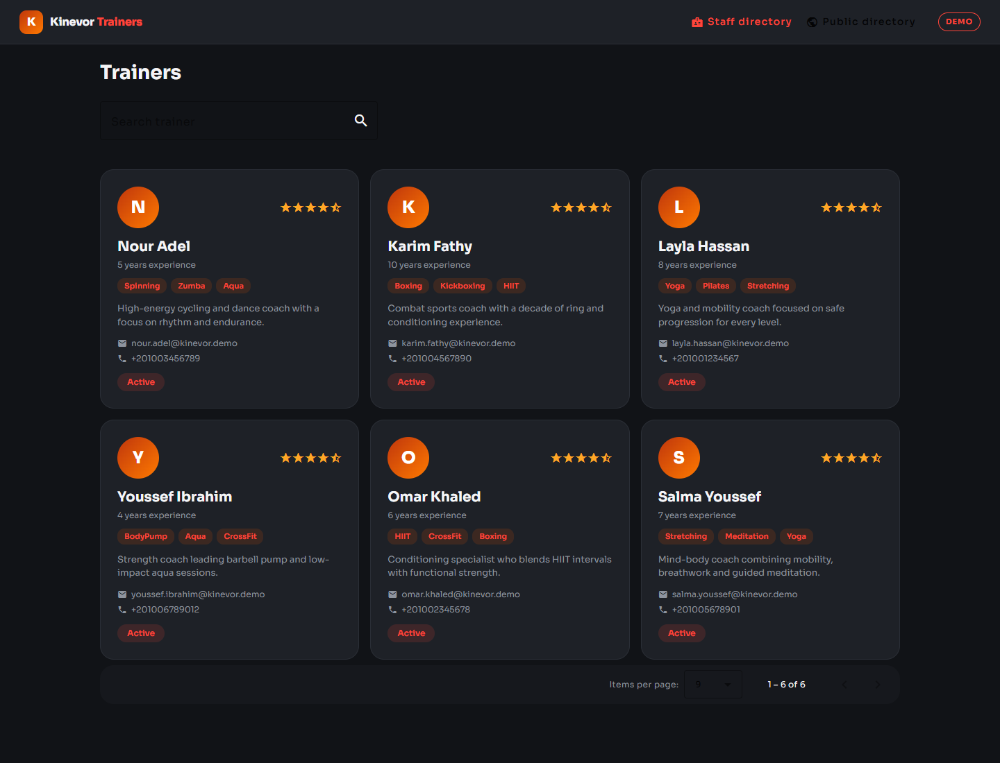
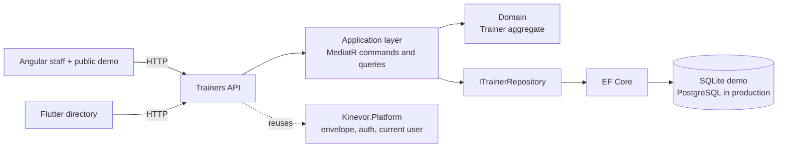
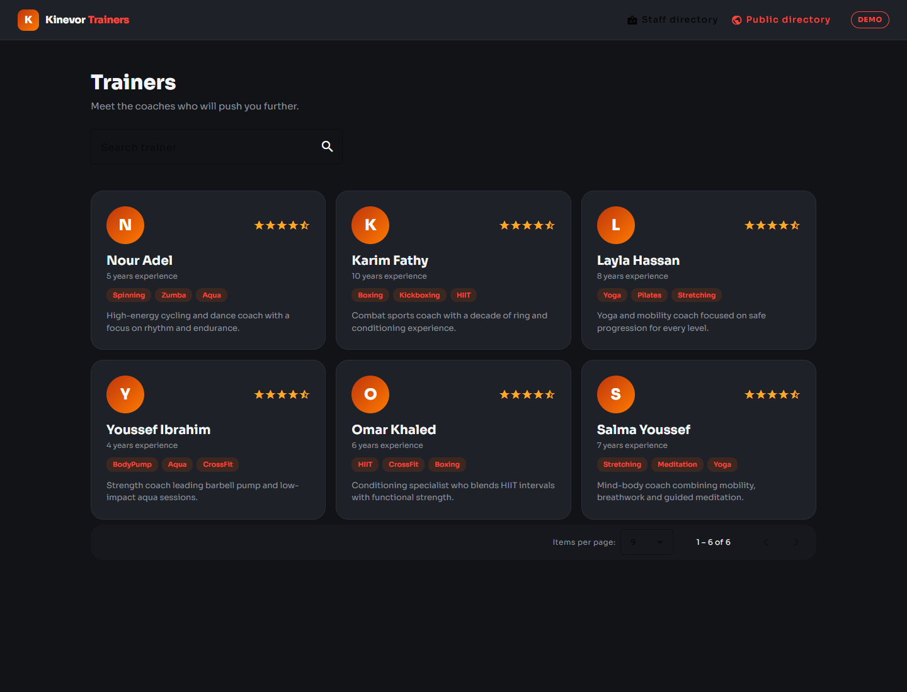
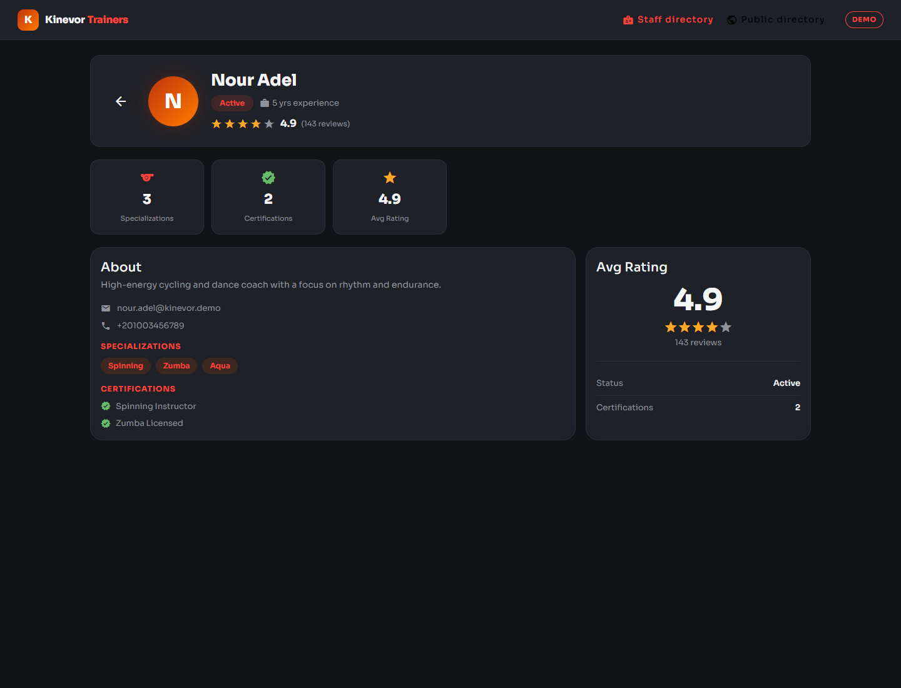
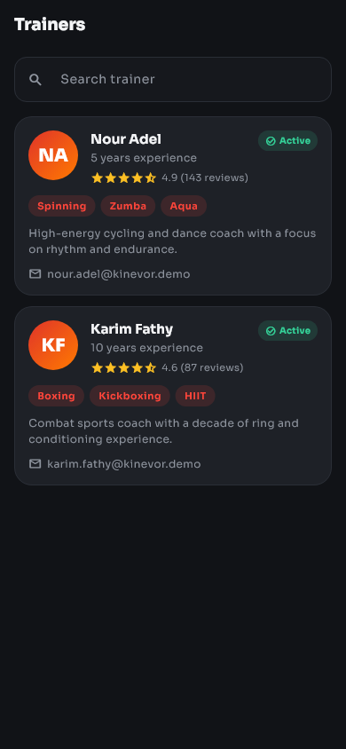
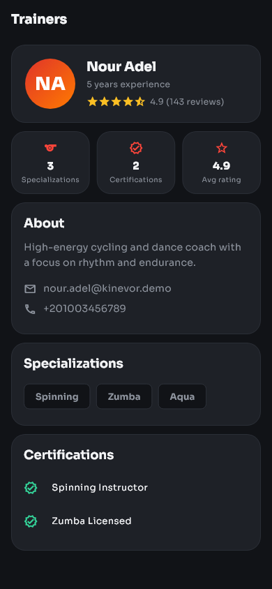
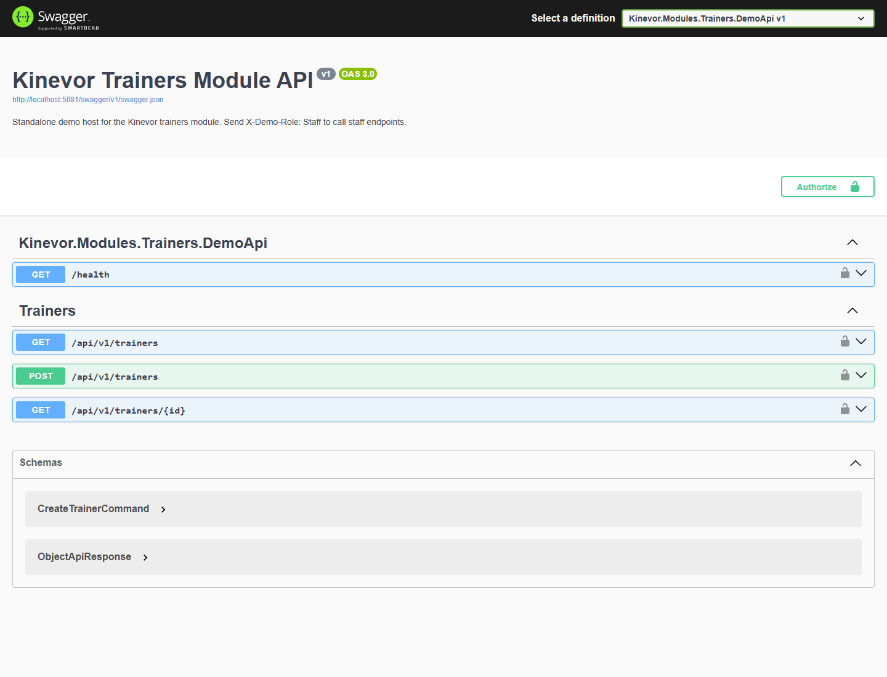

# Kinevor Trainers

Trainer directory vertical slice for the Kinevor gym platform: a .NET 9 API,
a standalone Angular library and demo, and a Flutter package with a runnable
example. Every layer can be consumed independently, and the demo runs locally
without the original Kinevor monorepo.

[](https://github.com/SoftwareDeveloper98/kinevor-trainers/actions/workflows/ci.yml)
[](https://github.com/SoftwareDeveloper98/kinevor-trainers/pkgs/nuget/Kinevor.Modules.Trainers)
[](https://github.com/SoftwareDeveloper98/kinevor-trainers/pkgs/npm/kinevor-trainers-web)
[](https://flutter.dev)
[](LICENSE)



## Why this module

The trainers slice is the pilot for the Kinevor modularization. It proves the
full path: domain and application code, a versioned NuGet package, an HTTP API,
an Angular package, a Flutter package, a demo for every client, and a CI/release
pipeline. The other Kinevor modules follow the same shape.

- Staff can search and browse trainers, then open a profile.
- A public directory route reuses the same read model for a member-facing page.
- The API exposes trainer creation for staff and admin provisioning.
- The web and mobile packages contain no host-specific routing or authentication.

## Architecture



The backend is organized into domain/application/API folders within a single project. The API
depends on the published `Kinevor.Platform.*` packages for the response
envelope, authorization policies and current-user abstractions. The Angular and
Flutter clients are thin presentation layers over a typed gateway/repository.

## Features

- Trainer list with free-text search, paging and active status.
- Trainer profile with bio, specializations, certifications, rating and
  experience.
- `Trainer` aggregate invariants: required identity, valid e-mail, non-negative
  rating and experience, normalized names.
- Platform `ApiResponse<T>` envelope and Problem Details errors.
- Staff/admin list and create policies; trainer-or-above profile policy.
- Angular: standalone components, Material UI, typed gateway/facade, public and
  staff routes, injectable providers, Vitest tests.
- Flutter: injectable repository/client, responsive directory, profile page,
  theme, test fakes and golden tests.
- SQLite demo with six seeded trainers and Swagger UI.

## Endpoints

| Method | Route | Policy | Used by |
| --- | --- | --- | --- |
| `GET` | `/api/v1/trainers?search=&page=&pageSize=` | `StaffOrAdmin` | Staff directory, demo public directory, Flutter directory |
| `GET` | `/api/v1/trainers/{id}` | `TrainerOrAbove` | Web profile, Flutter profile |
| `POST` | `/api/v1/trainers` | `StaffOrAdmin` | Admin provisioning; not exposed in the demo UI |
| `GET` | `/health` | anonymous | Demo health check |
| `GET` | `/swagger` | development only | API explorer |

The public demo route currently calls the staff read endpoint with the demo
`Staff` role. A production public host should expose a dedicated, unauthenticated
projection with the same response contract.

## Screenshots

### Web

| Staff directory | Public directory |
| --- | --- |
|  |  |

| Trainer profile |
| --- |
|  |

### Flutter

| Directory | Profile |
| --- | --- |
|  |  |

### API



## Quick start

### Prerequisites

- .NET SDK 10 (the solution uses `.slnx`) and the ASP.NET Core 9 runtime.
- Node.js 22+ and npm 10+.
- Flutter 3.35+ (the repository is verified with Flutter 3.47.7).

### 1. Build the platform packages

The backend restores `Kinevor.Platform.*` from the sibling platform repository's
local package feed. Clone it next to this repository and pack it once:

```powershell
git clone https://github.com/SoftwareDeveloper98/kinevor-platform.git ..\kinevor-platform
dotnet pack ..\kinevor-platform\backend\Kinevor.Platform.slnx -c Release `
  -o ..\kinevor-platform\backend\artifacts\packages
```

If the platform packages are published to GitHub Packages, configure that source
instead and skip the local pack step.

### 2. Run the API

```powershell
dotnet restore backend\Kinevor.Modules.Trainers.slnx
dotnet run --project backend\samples\Kinevor.Modules.Trainers.DemoApi
```

The API listens on `http://localhost:5081`. Open
`http://localhost:5081/swagger` for the explorer. The demo creates a SQLite
database and seeds six trainers on first run.

The demo trusts development-only headers:

| Header | Purpose | Example |
| --- | --- | --- |
| `X-Demo-Role` | Selects the authenticated role | `Staff`, `Trainer`, `Member`, `Admin` |
| `X-Demo-Email` | Sets the current user e-mail | `staff.demo@kinevor.local` |
| `X-Demo-Trainer` | Binds a trainer identity | trainer GUID |
| `X-Branch-Id` | Selects the branch context | branch GUID |

These headers are a demo adapter only. Never enable them in production.

### 3. Run the web demo

For local development, build the platform web package once:

```powershell
cd ..\kinevor-platform\web
npm install
npm run build
cd ..\..\kinevor-trainers\web
npm run install:local
npm start
```

`npm run install:local` temporarily points the workspace at the local platform
build, installs dependencies, restores `package.json`, and removes the generated
lockfile. When the package is published to GitHub Packages, authenticate the
scope in `.npmrc` and use the normal path instead:

```powershell
cd web
npm install
npm start
```

The web demo runs at `http://localhost:4200` with routes:

- `/trainers` - staff directory
- `/trainers/:id` - trainer profile
- `/public` - public trainer directory

The demo interceptor adds the `Staff` role header. A real host supplies its own
authentication and platform configuration.

### 4. Run the Flutter example

```powershell
cd mobile\packages\kinevor_trainers
flutter pub get
cd example
flutter run -d windows
```

For the browser, use port 4200 because the demo API allows that CORS origin:

```powershell
flutter run -d chrome --web-port 4200 `
  --dart-define=KINEVOR_API_BASE_URL=http://localhost:5081/api/v1
```

On an Android emulator use `http://10.0.2.2:5081/api/v1`.

### 5. Refresh screenshots

With both servers running:

```powershell
cd web
npm run capture:screenshots
```

The Playwright script writes the web and API images to `docs/screenshots`.
Regenerate the Flutter goldens with:

```powershell
cd mobile\packages\kinevor_trainers
flutter test --update-goldens test\trainers_golden_test.dart
```

## Testing

| Area | Command |
| --- | --- |
| Backend | `dotnet test backend\Kinevor.Modules.Trainers.slnx -c Release` |
| Web unit tests | `cd web; npm test` |
| Web builds | `cd web; npm run build:all` |
| Flutter analysis | `cd mobile\packages\kinevor_trainers; flutter analyze` |
| Flutter tests | `cd mobile\packages\kinevor_trainers; flutter test` |

The backend suite includes domain, application, repository and API tests against
the demo host. The web suite covers the HTTP gateway and facade with Vitest. The
Flutter suite covers the client, directory/profile widgets and golden images.

## Packages

| Ecosystem | Package | Contents |
| --- | --- | --- |
| NuGet | `Kinevor.Modules.Trainers` | Domain, application, API controller and module registration |
| NuGet | `Kinevor.Modules.Trainers.EntityFrameworkCore` | `TrainersDbContext`, mapping and repository |
| npm | `@softwaredeveloper98/kinevor-trainers-web` | Angular components, gateway, facade, providers and routes |
| Flutter | `kinevor_trainers` | API client, repository, widgets, theme and strings |

Install the Angular lib after authenticating to GitHub Packages:

```powershell
npm install @softwaredeveloper98/kinevor-trainers-web
```

Consume the Flutter package from the repository tag:

```yaml
dependencies:
  kinevor_trainers:
    git:
      url: https://github.com/SoftwareDeveloper98/kinevor-trainers.git
      path: mobile/packages/kinevor_trainers
      ref: v0.1.0
```

Both clients use the same API contract. The Angular package expects
`@softwaredeveloper98/kinevor-platform-web` as a peer dependency.

CI restores the platform NuGet and npm packages from GitHub Packages. Publish
`kinevor-platform` `0.1.0` first, or the backend and web jobs will fail at
restore/install.

## Design decisions

- **Vertical slice, platform reuse.** Trainer behavior stays in this repository;
  cross-cutting API, auth, i18n and theming stay in `kinevor-platform`.
- **Aggregate-first validation.** `Trainer` protects its invariants, and the
  application layer maps between commands and the aggregate.
- **Thin clients.** The Angular facade owns list/detail loading state; the Flutter
  package injects a repository so hosts can swap the HTTP implementation.
- **Demo auth is explicit.** The API only enables the trust headers in
  Development and the clients send them through a demo interceptor/client.
- **Search is provider-independent.** The EF repository currently filters in
  memory because `Email` is a value object with a converter. A normalized,
  indexed e-mail column is the follow-up for large data sets.
- **Visual contract in tests.** Golden tests and Playwright screenshots make
  typography, spacing and icon regressions visible.

## Repository layout

```text
kinevor-trainers/
  backend/
    src/Kinevor.Modules.Trainers/          domain, application, API
    src/Kinevor.Modules.Trainers.EntityFrameworkCore/
    samples/Kinevor.Modules.Trainers.DemoApi/
    tests/Kinevor.Modules.Trainers.Tests/
  web/
    projects/kinevor-trainers/             Angular library
    projects/demo/                         demo host
    scripts/                               local install + screenshots
  mobile/
    packages/kinevor_trainers/             Flutter package
    packages/kinevor_trainers/example/     runnable demo
  docs/
    screenshots/
  .github/workflows/
```

## Related modules

- [Kinevor Platform](https://github.com/SoftwareDeveloper98/kinevor-platform) -
  shared API, auth, i18n, notices and Angular primitives.
- [Kinevor Members](https://github.com/SoftwareDeveloper98/kinevor-members)
- [Kinevor Memberships](https://github.com/SoftwareDeveloper98/kinevor-memberships)
- [Kinevor Classes & Bookings](https://github.com/SoftwareDeveloper98/kinevor-classes-bookings)
- [Kinevor Check-ins & Access](https://github.com/SoftwareDeveloper98/kinevor-checkins-access)
- [Kinevor Payments & Billing](https://github.com/SoftwareDeveloper98/kinevor-payments-billing)
- [Kinevor Public Site](https://github.com/SoftwareDeveloper98/kinevor-public-site)
- [Kinevor Staff Dashboard](https://github.com/SoftwareDeveloper98/kinevor-staff-dashboard)
- [Kinevor Notifications](https://github.com/SoftwareDeveloper98/kinevor-notifications)
- [Kinevor Identity & Access](https://github.com/SoftwareDeveloper98/kinevor-identity-access)

## Release Checklist

- Confirm `kinevor-platform` `v0.1.0` is published.
- Add the `KINEVOR_PACKAGES_TOKEN` repository secret.
- Push tag `v0.1.0` after CI is green.

See [PUBLISHING.md](PUBLISHING.md) for the complete release and consumer setup.

## Security

The demo role headers are intentionally insecure and exist only for local
screenshots and tests. Production hosts must use the platform authentication
stack, enforce the published policies, and keep the demo adapter disabled. Do not
commit connection strings, PATs or `.env` files.

## License

MIT. See [LICENSE](LICENSE).
