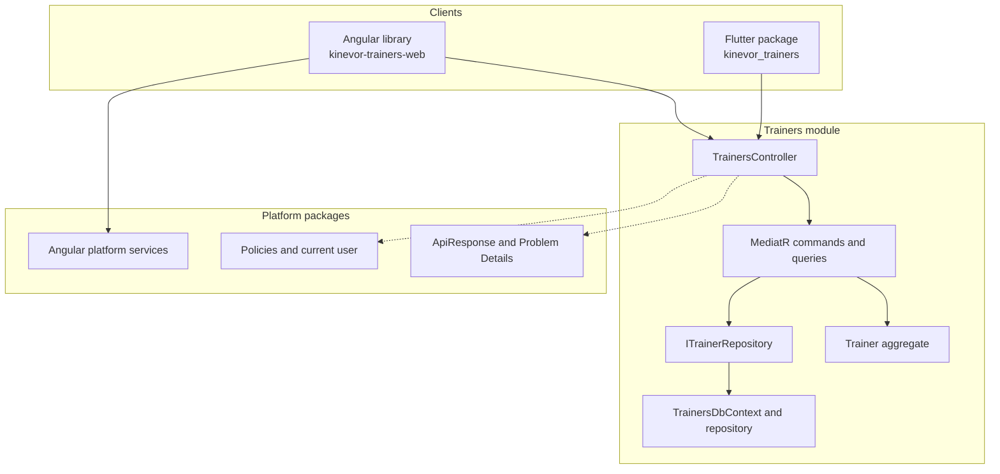

# Trainers architecture

## Boundaries

The module owns trainer behavior and persistence. The platform owns the response
envelope, authorization, current-user/branch context and Angular primitives.
Clients own presentation and host integration, not authentication.

## Backend flow

1. `TrainersController` receives an authenticated request.
2. `GetTrainersQuery` or `GetTrainerByIdQuery` is dispatched through MediatR.
3. The handler reads `ITrainerRepository` and maps the aggregate to
   `TrainerSummaryDto`.
4. `TrainersController` wraps the result in `ApiResponse<object>`.
5. `TrainerRepository` filters and pages through `TrainersDbContext`.

Create flow:

1. `CreateTrainerCommand` is validated by the handler.
2. `Trainer.Create` enforces aggregate invariants.
3. The repository adds and saves the aggregate.
4. The controller returns `201 Created` with the new id.

## Persistence

The demo uses SQLite and `EnsureCreatedAsync`. Production hosts should configure
PostgreSQL and migrations. The EF search currently loads matching trainers and
filters in memory because the e-mail value object uses a converter. The planned
fix is a normalized `Email` column with an index, then push search into SQL.

## Client flow

### Angular

`TrainersFacade` exposes list and detail state. It calls `TRAINERS_GATEWAY`,
which defaults to `HttpTrainersGateway` using the platform API client. The host
provides `provideTrainers()` and either staff or public routes. Authentication
and base URL come from `provideKinevorPlatform()`.

### Flutter

`TrainersDirectory` calls `TrainersRepository`. `RemoteTrainersRepository`
delegates to `KinevorTrainersClient`, which handles the API envelope and
Problem Details. `TrainersScreen` wires the list and detail pages; the example
injects the demo headers.

## Demo trust boundary

The DemoApi maps `X-Demo-Role` and related headers to a development identity.
This adapter exists only in the demo host. Production composition must provide
the platform authentication handler and disable the demo adapter.

## Testing strategy

- Domain tests exercise invariants.
- Application tests use a fake repository.
- API tests boot the DemoApi with SQLite and assert the envelope.
- Angular tests cover the HTTP gateway and facade with Vitest.
- Flutter tests cover the client, list/profile states and goldens.
- Playwright captures the live demo for README images.
